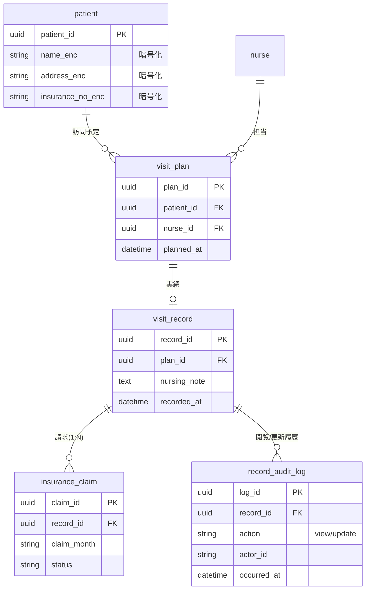
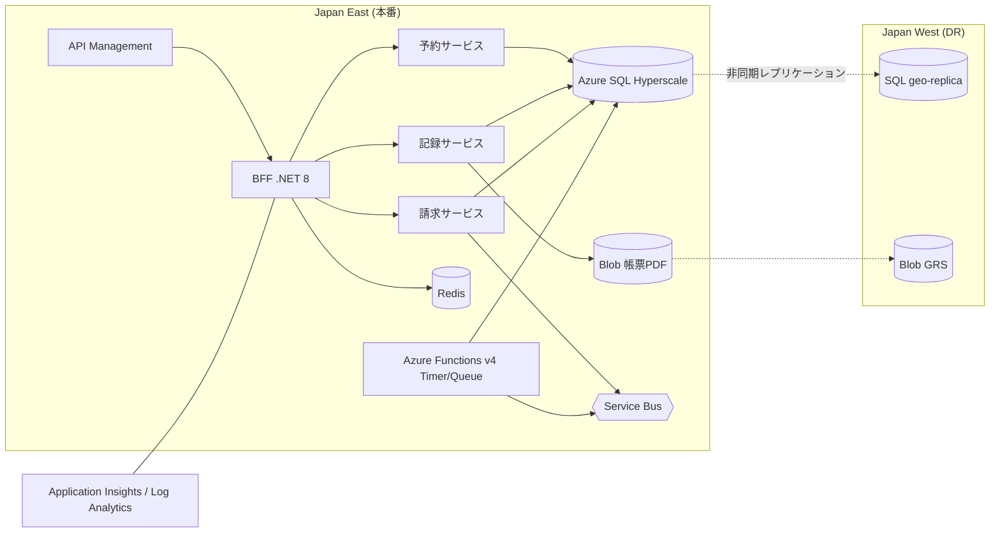

# CareRoute Hub 設計断片(架空)

研修用の架空データです。「添付のER図」「添付のデプロイ図」として Issue に添付、またはリポジトリの `docs/` に置いて使います。

## ER図(抜粋)

## デプロイ図(抜粋)

## 監査ログ設計書(未完成のドラフト)

| 項目 | 内容 |
| --- | --- |
| 対象 | 看護記録の閲覧/更新 |
| 保持 | 7年 |
| 出力先 | Log Analytics カスタムテーブル `CareAudit_CL`(列定義は未確定) |
| 確定済み列 | `TimeGenerated`, `ActorId`, `Action`, `RecordId` |
| 未確定 | 患者識別子のマスキング方式、アーカイブ先(Basic Logs / Storage)、取り込み遅延の許容値 |
